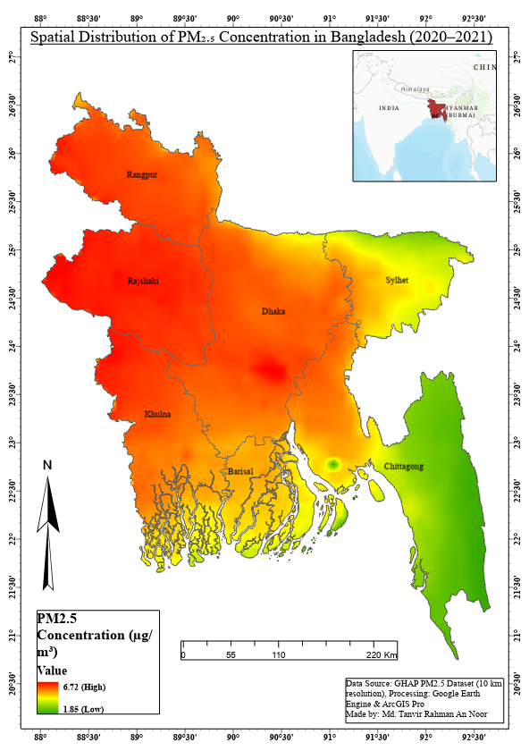

# Air Quality (Sentinel-5P) and PM2.5 Spatial Analysis of Bangladesh

* **Tools Used:** Google Earth Engine (JavaScript API), ArcGIS Pro
* **Datasets:** Sentinel-5P TROPOMI (2023) & GHAP Satellite PM2.5 Data (2020–2021)
* **Methodology:**
  1. **Multi-Pollutant Air Quality Analysis:** Processed annual mean concentrations of five atmospheric pollutants (NO2, CO, SO2, O3, CH4) in GEE and designed an A3 multi-panel layout in ArcGIS Pro.
  2. **Regional PM2.5 Assessment:** Evaluated and mapped gridded PM2.5 concentration surfaces across Bangladesh.

### 1. Multi-Pollutant Air Quality Map (Sentinel-5P)

### 2. PM2.5 Concentration Map of Bangladesh

